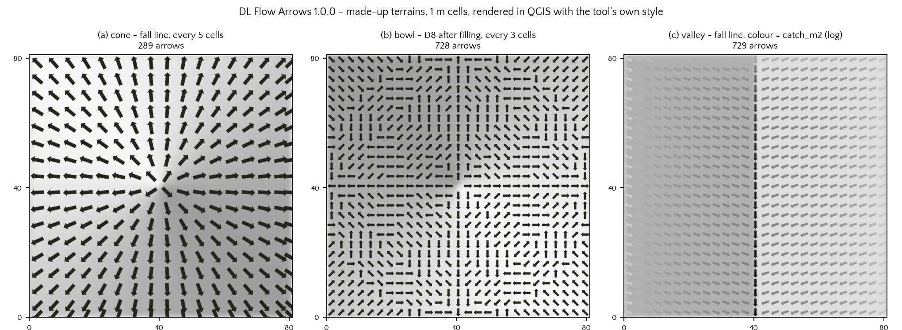
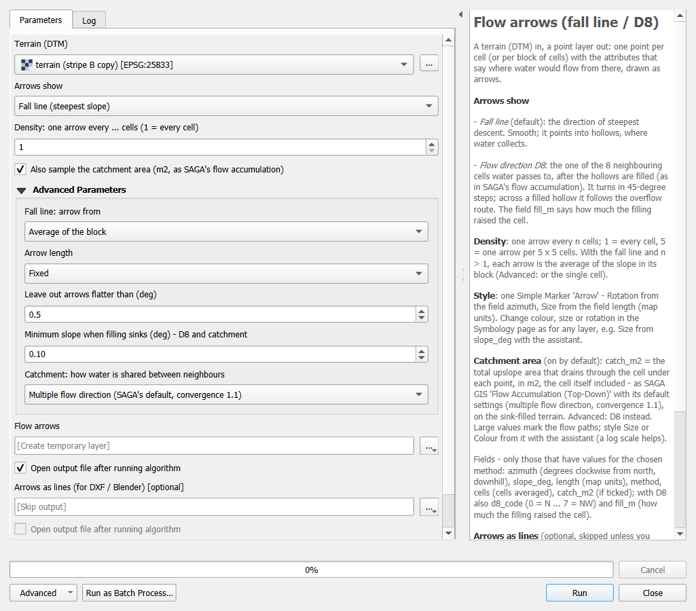
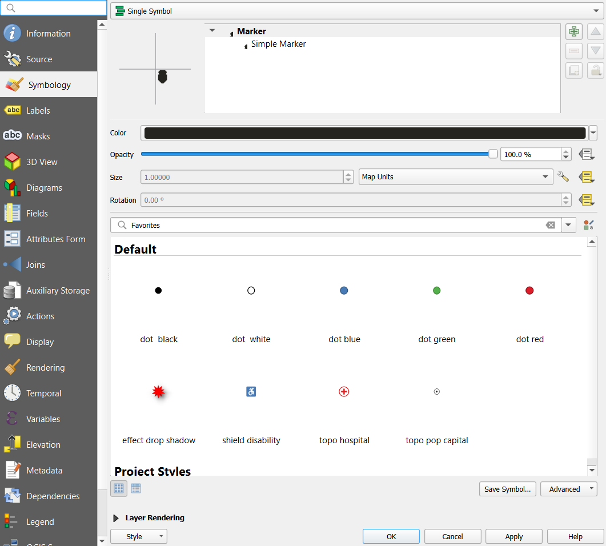

# DL Flow Arrows

A QGIS Processing script by [Digital Landscapes](https://digital-landscapes.com). A terrain (DTM) goes in. A point
layer comes out: one point per cell, or per block of cells. Its attributes say where water would flow from there and
how much area drains through it. The points are drawn as arrows by one standard QGIS symbol, which you restyle like any
point layer.

- **Two meanings of "where water flows":**
  - **Fall line** (default): the direction of steepest descent. It is continuous and points *into* hollows, where water
    collects.
  - **Flow direction D8**: the one of the 8 neighbouring cells that water passes to, once the hollows are filled. It
    turns in 45° steps; inside a filled hollow it follows the overflow route.
- **Catchment area** (`catch_m2`, on by default): the total upslope area that drains through the cell under each point,
  in m², the cell itself included. It is computed the way SAGA GIS's *Flow Accumulation (Top-Down)* does with its
  default settings (multiple flow direction, convergence 1.1). D8 routing is an option.
- **Density:** one arrow every *n* cells (default: every cell). With the fall line and *n* > 1, each arrow is the mean
  slope direction of its block.
- **One standard style:** a Simple Marker *Arrow*. Its Rotation comes from `azimuth` and its Size from `length`; both
  are data-defined, on the rows where the Symbology page and its assistant expect them.
- **Arrows as lines** (optional): one straight line per arrow, drawn downhill, for DXF or Blender.

The directions come from QGIS's own algorithms: `native:aspect` / `native:slope` (Horn's 3×3 method) for the fall line
and `native:fillsinkswangliu` (QGIS's port of SAGA's Wang & Liu sink filling) for D8 and the catchment. The script adds
the sampling, the catchment routing, the attributes, the geometry and the style.

## Install

Written for **QGIS 3.44 LTR** and tested on Windows with QGIS 3.44.12. Other QGIS versions, macOS and Linux have not
been tested yet. The self-test below tells you within seconds whether it works on your computer.

1. Download `dl_flow_arrows.py` from the [latest release](../../releases/latest).
2. In QGIS: **Processing › Toolbox**, the Python icon at the top › **Add Script to Toolbox…** › choose the file.
3. The tool is under **Scripts › DL QGIS Code › Flow arrows (fall line / D8)**.

**Updating:** first close QGIS and delete every older copy of the tool from your profile's scripts folder:
`…/QGIS3/profiles/default/processing/scripts/`. That includes renamed copies such as `dl_flow_arrows old.py`. Then add
the new file. When several files define the same tool, QGIS uses only the first one by name and gives no warning, so
an old copy hides the update. The help panel in the tool's dialog shows which version runs.

## Check that it works on your computer

`selftest/dl_flow_arrows_selftest.py` (also attached to each release) runs in QGIS: **Plugins › Python Console › Show
Editor › Open Script…** › the file › **Run Script**. It uses the tool as installed and makes small made-up terrains in a
temporary folder. It then runs 12 checks with known answers, for example arrows on tilted planes, a cone, a bowl, and
catchment values on a plane. It also checks that only one copy of the tool is installed. The report appears in the
Python Console. Your project is not changed. If a check fails, please send us the report: it names your operating
system and the QGIS, Python, numpy and GDAL versions, nothing personal.

## Use

| Setting | What it does |
|---|---|
| Terrain (DTM) | Any single-band elevation raster in a projected coordinate system (metres). Rotated rasters are refused. |
| Arrows show | Fall line (default) or Flow direction D8. |
| Density | One arrow every *n* cells; 1 = every cell. Above 500,000 arrows the tool warns and suggests a density. |
| Also sample the catchment area | On by default; adds `catch_m2`. |
| *Advanced:* Fall line: arrow from | Average of the block (default) or the block's middle cell. |
| *Advanced:* Arrow length | Fixed, 0.8 × the distance between arrows (default), or longer where steeper. |
| *Advanced:* Leave out arrows flatter than | 0.5° by default. Flat ground never gets an arrow. |
| *Advanced:* Minimum slope when filling sinks | 0.1° by default. Used by D8 and the catchment. |
| *Advanced:* Catchment routing | Multiple flow direction (SAGA's default, convergence 1.1) or D8. |
| Arrows as lines | Optional output; skipped unless you choose a file or a temporary layer. |

### Fields

Each layer has only the fields of its run.

| Field | Meaning |
|---|---|
| `azimuth` | Downhill direction, degrees clockwise from north |
| `slope_deg` | Slope in degrees (for a block: the slope of its mean direction) |
| `length` | Arrow length in map units |
| `method` | `fall line`, `fall line (block mean)`, `fall line (cell)` or `D8` |
| `cells` | Number of cells averaged |
| `catch_m2` | Catchment area in m² (if ticked) |
| `d8_code` | D8 only: 0 = N, 1 = NE … 7 = NW |
| `fill_m` | D8 only: how much the sink filling raised the cell, in metres |

All names have 10 characters or fewer, so a shapefile keeps them.

### Style

Change colour, shape or size on the Symbology page as on any point layer. The yellow buttons next to Size and Rotation
show the links to the fields; Rotation must stay linked to `azimuth`, or the arrows lose their direction. For the
catchment, use a logarithmic scale, for example a colour expression such as
`ramp_color('Greys', scale_linear(log10("catch_m2"), 0, 4, 0.12, 1))`, as in panel (c) above. The default style is
also in [`styles/`](styles/) as `.qml` files (Symbology › Style › Load Style…).

## How it was checked

All results below were measured with QGIS 3.44.12 and numpy 2.4.6 on Windows. The test terrains are made-up surfaces
and two 1 m survey DTMs; the survey DTMs are not part of this repository.

- **Fall line:** on tilted planes in 10 directions, every arrow is within 0.0001° of the true downhill direction.
  QGIS's `native:aspect` matched an independent computation of Horn's formula with a difference of 0.000°.
- **D8:** on the same planes, every arrow is the nearest 45° step.
- **Catchment, against SAGA GIS 9.12.4 itself** (`saga_cmd ta_hydrology 0`, the copy that ships with QGIS):
  - on SAGA's own filled terrain, the routing in this script matches SAGA on **100 %** of the cells: D8 exactly, MFD
    to within 0.0001 %;
  - through the tool, which fills sinks with QGIS's port, MFD is within 1 % of SAGA on **99.92 %** and **99.99 %** of
    the cells of the two DTMs;
  - D8 is within 1 % on 98.65 % and 98.47 %. QGIS's and SAGA's filled terrains differ by up to 0.1 mm, and inside
    filled hollows that is enough to turn single D8 directions. **Use MFD when the values must match SAGA.**
- **Conservation:** on every test terrain, the water that ends in a cell plus the water that leaves the grid adds up
  to the total area.

### Good to know

- **Edges:** like SAGA, water can leave the grid over the edge with MFD, and edge cells pass no water on with D8.
  Values near the edge of a terrain therefore only count the area inside it.
- **Memory:** the whole raster is read into memory. A 154 × 292-cell terrain takes about 1 second with the catchment;
  much larger rasters have not been timed.
- **Side files:** QGIS itself writes a small `<raster>.aux.xml` file (GDAL statistics) next to a raster file it loads.
  That file comes from QGIS, not from this tool.

## Cite

If you use DL Flow Arrows in teaching or research, please cite it. See [`CITATION.cff`](CITATION.cff); GitHub's "Cite
this repository" button gives APA and BibTeX.

> Ihle, M. (2026). *DL Flow Arrows* (Version 1.0.0) [Computer software]. Digital Landscapes.
> https://doi.org/10.5281/zenodo.23723034

To cite the tool in general rather than this version, use the DOI for all versions,
[10.5281/zenodo.23723033](https://doi.org/10.5281/zenodo.23723033). It always resolves to the newest release.

## Licence

GNU General Public License, version 3 or later. See [`LICENSE`](LICENSE). Copyright 2026 Marc Ihle (Digital
Landscapes). The credits for the open-source work this builds on are in [`CREDITS.md`](CREDITS.md).
